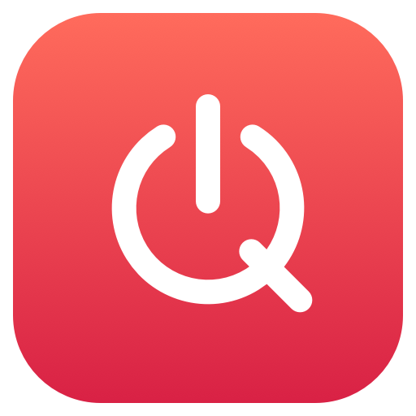
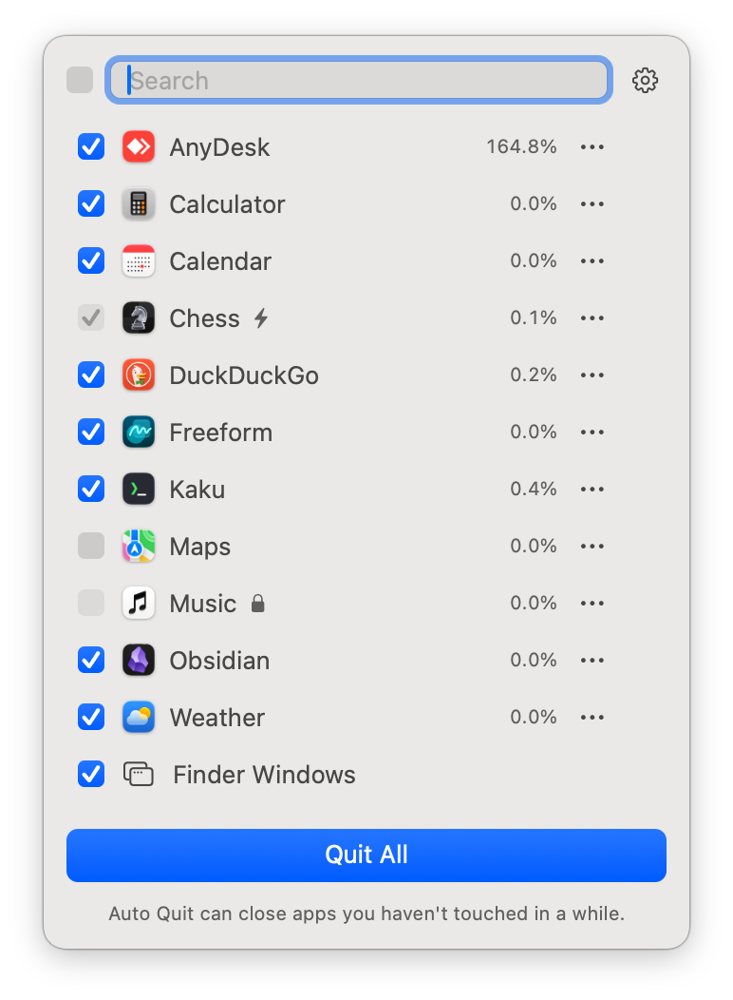
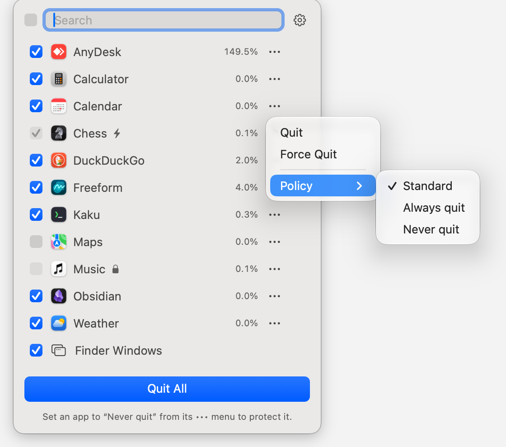
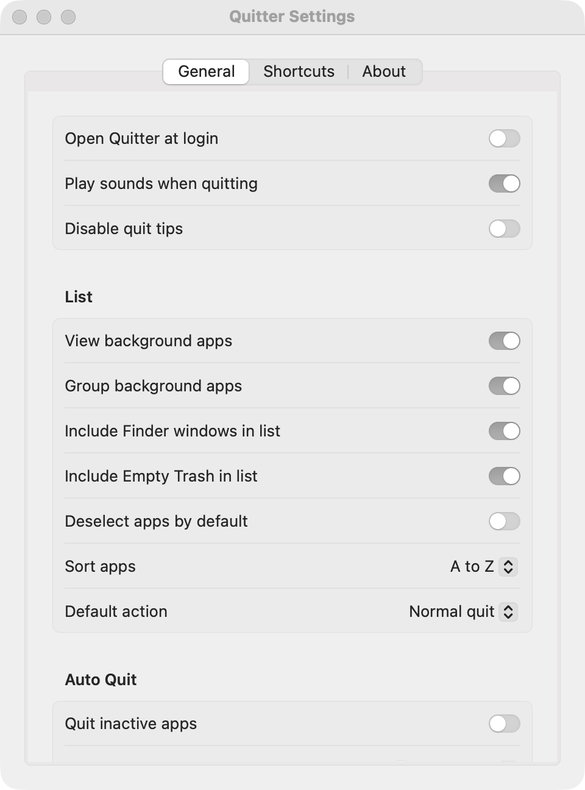
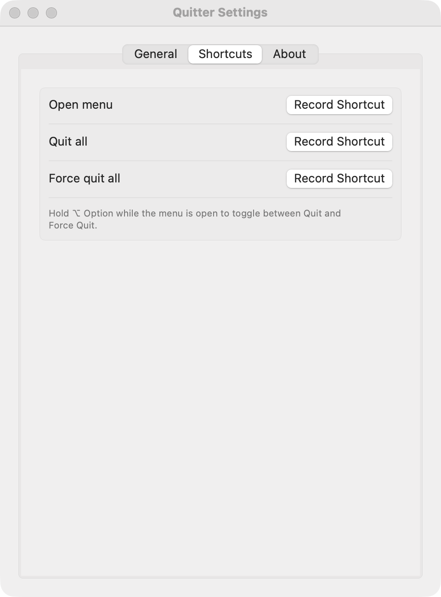
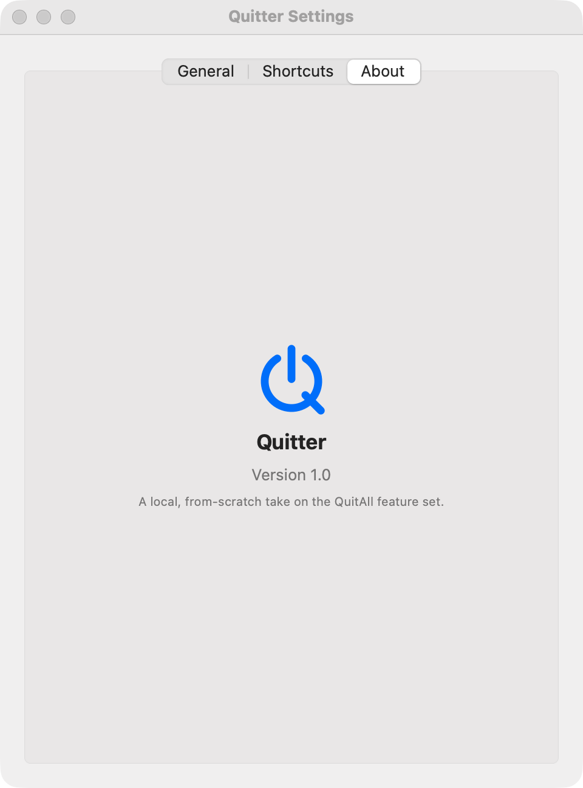

<div align="center">



# Quitter

**Quit every app on your Mac from the menu bar: one click, or one shortcut.**

[](https://github.com/MagnusMagi/Quitter/actions/workflows/ci.yml)
[](LICENSE)


<br>


[](https://github.com/MagnusMagi/Quitter/commits/main)
[](https://github.com/MagnusMagi/Quitter/stargazers)



</div>

---

Quitter lives in your menu bar and shows every running app with its CPU or memory use. Tick the apps you want gone and hit **Quit All**. Hold <kbd>⌥ Option</kbd> and it becomes **Force Quit All**. Protect the apps you never want closed, always sweep away the ones you do, and let **Auto Quit** clean up apps you haven't touched in a while.

It's a small, native, dependency-free Swift app. It doesn't phone home, has no accounts or analytics, and builds from source in about a minute.

## Contents

- [Screenshots](#screenshots)
- [Features](#features)
- [Install](#install)
- [Usage](#usage)
- [Settings reference](#settings-reference)
- [Privacy & permissions](#privacy--permissions)
- [How it works](#how-it-works)
- [Development](#development)
- [FAQ](#faq)
- [Roadmap](#roadmap)
- [Contributing](#contributing)
- [License](#license)

## Screenshots

<table>
  <tr>
    <td align="center" width="50%"><br><sub>Hold <kbd>⌥</kbd> to switch to <b>Force Quit All</b></sub></td>
    <td align="center" width="50%"><br><sub>Per-app <b>•••</b> menu with Quit, Force Quit and Policy</sub></td>
  </tr>
</table>

<table>
  <tr>
    <td align="center" width="33%"><br><sub>General</sub></td>
    <td align="center" width="33%"><br><sub>Shortcuts</sub></td>
    <td align="center" width="33%"><br><sub>About</sub></td>
  </tr>
</table>

## Features

### The panel

- 🧹 **Quit All / Force Quit All**: quit every selected app at once. Hold <kbd>⌥ Option</kbd> while the panel is open to flip between normal and force quit; the button turns red.
- ☑️ **Pick what goes**: a checkbox per app, plus a select-all box in the header.
- 🔍 **Search** to filter the list as you type.
- 📊 **Live CPU % or memory** for each app, refreshed every couple of seconds only while the panel is open.
- ↕️ **Six sort orders**: A→Z, Z→A, CPU high/low and memory high/low, right from the ⚙︎ menu.
- 🎯 **Click an app's name** to bring it to the front. Hover a row for a one-click ✕ quit button.
- ⌨️ **Keyboard first**: <kbd>Return</kbd> runs Quit All, <kbd>Esc</kbd> closes the panel.
- 💡 **Tips** in the footer rotate through hidden features. You can turn them off.

### Per-app policies

Each app's **•••** menu has a **Policy**:

| Policy | Checkbox | Quit All | Manual quit | Auto Quit | Badge |
|---|---|---|---|---|---|
| **Standard** | yours to toggle | if ticked | ✅ | ✅ | none |
| **Always quit** | locked on | always | ✅ | ✅ | ⚡ |
| **Never quit** | locked off | never | ❌ | never | 🔒 |

Policies are stored by bundle identifier, so they survive relaunches and app updates.

### Beyond regular apps

- 🗂 **Finder windows**: optionally list a row that closes every open Finder window, without quitting Finder itself.
- 🗑 **Empty Trash**: optionally list a row that empties the Trash as part of Quit All.
- 👻 **Background apps**: optionally show agents and menu bar apps too, either mixed in or tucked into a collapsible group.

### Auto Quit

- ⏱ Quits apps you haven't used for a set time: 1–999 minutes, hours or days.
- 🔔 Sends a notification **30 seconds before** quitting. Switch to the app in that window and the quit is cancelled.
- 🛡 Never touches the frontmost app, background apps, or apps set to **Never quit**.
- 🎵 Skips music apps (Music, Spotify) by default, so your playlist keeps going.
- 💾 Uses a normal quit, so apps still get to ask about unsaved documents.

### System integration

- ⌨️ **Three global shortcuts**: open the panel, Quit All, Force Quit All. Record any combination you like.
- 🚀 **Open at login** through the modern `SMAppService` API, with no helper app.
- 🔊 **Sounds** on quit (optional) and **notifications** after Quit All.
- 🖥 Opens on whichever Space you're in, **including full-screen apps**, without stealing focus.
- 🌗 Light and dark mode, and a template menu bar icon that follows your menu bar's appearance.
- ♿️ VoiceOver labels on every control.

## Install

Quitter is built from source; there's no notarized download yet.

**Requirements:** macOS 14 Sonoma or later, plus Xcode 16 or the Swift 6 command line tools (`xcode-select --install`).

```bash
git clone https://github.com/MagnusMagi/Quitter.git
cd Quitter
./build.sh
open ~/Applications/Quitter.app
```

`build.sh` does a release build, wraps it into `Quitter.app`, ad-hoc signs it and copies it to `~/Applications`. Since you built it yourself, Gatekeeper won't complain.

To start it with your Mac, turn on **Settings → General → Open Quitter at login**.

### Uninstall

Quit Quitter from its ⚙︎ menu, then:

```bash
rm -rf ~/Applications/Quitter.app
defaults delete local.magi.quitter   # optional: forget settings and policies
```

## Usage

1. Click the **⏻ Q** icon in the menu bar, or press your *Open menu* shortcut.
2. Untick anything you want to keep.
3. Press **Quit All** (or <kbd>Return</kbd>). Hold <kbd>⌥</kbd> first for **Force Quit All**.

On first launch the Settings window opens so you can set things up. You can always get back to it from **⚙︎ → Settings…** in the panel.

### Keyboard reference

| Where | Key | Action |
|---|---|---|
| Anywhere | *your shortcut* | Open/close the panel |
| Anywhere | *your shortcut* | Quit All selected apps |
| Anywhere | *your shortcut* | Force Quit All selected apps |
| Panel | <kbd>⌥ Option</kbd> (hold) | Toggle Quit ↔ Force Quit |
| Panel | <kbd>Return</kbd> | Run Quit All / Force Quit All |
| Panel | <kbd>Esc</kbd> | Close the panel |

Global shortcuts are unset until you record them in **Settings → Shortcuts**.

## Settings reference

| Setting | Default | What it does |
|---|---|---|
| Open Quitter at login | off | Registers Quitter as a login item. |
| Play sounds when quitting | on | Plays a short sound after a quit. |
| Disable quit tips | off | Hides the rotating tips under the button. |
| View background apps | off | Lists agents and menu bar apps too. Some relaunch themselves when quit. |
| Group background apps | off | Puts background apps in a collapsible section of their own. |
| Include Finder windows in list | off | Adds a row that closes all Finder windows. |
| Include Empty Trash in list | off | Adds a row that empties the Trash. |
| Deselect apps by default | off | New apps start unticked instead of ticked. |
| Sort apps | A to Z | List order; also switchable from the panel. |
| Default action | Normal quit | Makes Force Quit the default (⌥ then flips it back). |
| Quit inactive apps | off | Turns on Auto Quit. |
| After *N* *unit* | 30 minutes | How long an app must be unused before Auto Quit takes it. |
| Never quit music apps | on | Auto Quit skips Music and Spotify. |
| Reset all settings… | | Restores defaults and clears every policy and checkbox. |

## Privacy & permissions

- **No network access.** Quitter makes no network requests at all: no analytics, crash reporting, update checks or accounts.
- **Settings stay local** in `~/Library/Preferences/local.magi.quitter.plist`.
- **Automation (Finder)**: only when you use the *Finder windows* or *Empty Trash* rows, macOS asks once whether Quitter may control Finder. Say no and everything else still works.
- **Notifications**: asked for on first launch; used for Quit All results and Auto Quit warnings.
- **No Accessibility or Screen Recording permission needed.** Hotkeys use the Carbon `RegisterEventHotKey` API, which doesn't require them.

## How it works

| Piece | Implementation |
|---|---|
| Menu bar item | `NSStatusItem` with a template image drawn in code ([`Logo.swift`](Sources/Quitter/Logo.swift)) |
| Panel | Borderless, non-activating `NSPanel` hosting SwiftUI. It can take keyboard focus without activating the app, and joins all Spaces so it shows over full-screen apps |
| App list | `NSWorkspace.runningApplications`, filtered by activation policy |
| CPU / memory | `proc_pid_rusage`: CPU time deltas between samples and physical footprint, sampled only while the panel is visible |
| Quitting | `NSRunningApplication.terminate()` / `forceTerminate()` |
| Finder & Trash | `NSAppleScript` → Finder |
| Global shortcuts | Carbon `RegisterEventHotKey` ([`HotKeys.swift`](Sources/Quitter/HotKeys.swift)) |
| Auto Quit | Last-activation timestamps from `NSWorkspace` notifications, checked every 30 s |
| Login item | `SMAppService.mainApp` |
| Settings | `UserDefaults` / `@AppStorage` |

Selection, policy, sorting and Auto Quit rules are pure functions in the `QuitterCore` module, so they're unit-tested without AppKit.

```
Sources/
├── QuitterCore/      # pure logic: sorting, policies, selection, Auto Quit candidates
└── Quitter/
    ├── main.swift          # NSApplication bootstrap (accessory app, no Dock icon)
    ├── AppDelegate.swift   # status item, panel, settings window, hotkey wiring
    ├── AppsManager.swift   # running apps, sampling, quitting, Auto Quit
    ├── MenuView.swift      # the panel UI
    ├── PrefsView.swift     # Settings window (General / Shortcuts / About)
    ├── Prefs.swift         # defaults keys, shortcut model + recorder
    ├── HotKeys.swift       # Carbon global hotkeys
    └── Logo.swift          # menu bar glyph
Tests/QuitterCoreTests/     # Swift Testing suite
```

## Development

```bash
swift build          # debug build
swift test           # run the test suite
./build.sh           # release build, installed to ~/Applications
```

Open `Package.swift` in Xcode if you'd rather use the IDE. CI builds and tests every push and pull request on macOS.

## FAQ

<details>
<summary><b>An app didn't quit. Why?</b></summary>

A normal quit asks the app nicely. Apps with unsaved changes may show a save dialog and wait for you. Use **Force Quit** (hold <kbd>⌥</kbd>) if you really want it gone. Apps set to **Never quit** are always skipped.
</details>

<details>
<summary><b>A background app came straight back after quitting.</b></summary>

Some agents are relaunched by `launchd` or by their parent app. That's up to them, not Quitter. Set them to **Never quit**, or turn off *View background apps*.
</details>

<details>
<summary><b>Will Force Quit lose my work?</b></summary>

It can. Force quit kills the process immediately without letting it save. Auto Quit never force quits.
</details>

<details>
<summary><b>Does Quitter quit itself or Finder?</b></summary>

No. Quitter never lists itself, and the Finder row only closes Finder's windows.
</details>

<details>
<summary><b>The panel doesn't appear.</b></summary>

Make sure you're on macOS 14 or later and that the icon isn't hidden by a menu bar manager or the notch. Then try your *Open menu* shortcut.
</details>

## Roadmap

- [ ] Notarized, signed release builds on GitHub Releases
- [ ] Homebrew cask
- [x] App icon
- [ ] Readable labels for function and arrow keys in the shortcut recorder
- [ ] Localization

Ideas and PRs are welcome. Open an issue first for anything big.

## Contributing

1. Fork and create a branch: `git checkout -b feat/my-change`.
2. Keep it small, native and dependency-free.
3. Add or update tests in `Tests/QuitterCoreTests` for any logic change, and run `swift test`.
4. Use [Conventional Commits](https://www.conventionalcommits.org/) (`feat:`, `fix:`, `docs:` …) and open a PR.

## License

[MIT](LICENSE) © 2026 Magnus Mägi

<sub>Quitter is an independent, from-scratch project inspired by the feature set of QuitAll. It is not affiliated with or endorsed by QuitAll, Setapp or MacPaw, and contains none of their code or assets.</sub>
